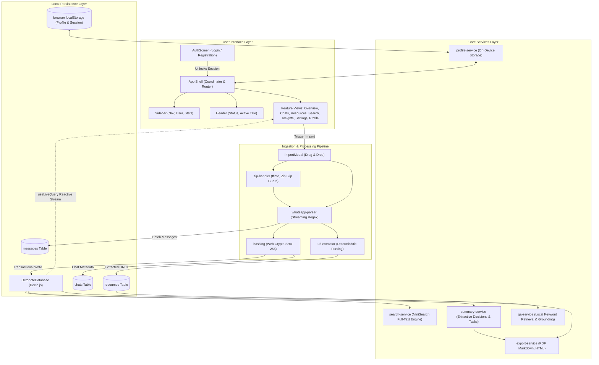

# Octonote Architecture & Design

This document details the architectural principles, system design, directory organization, and data flow of **Octonote**.

---

## 1. Architectural Philosophy

Octonote is built on four core principles:

1. **Local-First & Zero Egress**: All parsing, storage, full-text indexing, resource extraction, and summarization occur strictly on the client device. The application performs zero network requests to external APIs or remote databases.
2. **Deterministic & Verifiable**: Instead of relying on non-deterministic external LLMs that hallucinate, Octonote uses pure, testable algorithms. Every extracted resource, decision, and action item retains traceable pointers to its exact source message and line number.
3. **Reactive Local Storage**: The user interface reflects changes instantaneously using `dexie-react-hooks` (`useLiveQuery`). When a new chat is imported or deleted, all connected views (Overview, Chats, Resources, Search, Insights) update automatically without manual page reloads.
4. **Clean Layer Separation**: Pure business logic (parsers, extractors, storage queries, export generators) lives in `src/core/` and remains completely decoupled from React presentation components.

---

## 2. System Overview Diagram



---

## 3. Directory Breakdown

The codebase is organized into modular layers:

### `src/app/`
- **`App.tsx`**: Top-level coordinator. Manages:
  - Active navigation state (`currentTab`: `'overview' | 'chats' | 'resources' | 'search' | 'insights' | 'settings' | 'profile'`).
  - Device session state (`currentUser`, `isSessionUnlocked`).
  - Active preview state for the import modal.
  - Cross-tab message deep-linking (`targetChatId`, `targetMessageId`).
- **`App.test.tsx`**: End-to-end integration test suite verifying the complete flow from upload, parsing, and persistence to search, summarization, Q&A, and session lock.

### `src/components/`
- **`layout/Header.tsx`**: Displays active view titles, live local-storage indicator, quick import trigger, and active user profile badge.
- **`layout/Sidebar.tsx`**: Responsive collapsible navigation bar with branding, tab buttons, quick import trigger, and active user profile card with session lock button.
- **`modals/ImportModal.tsx`**: Interactive drag-and-drop modal supporting `.txt` and `.zip` files, real-time streaming line parsing, warning reporting, participant counts, date span detection, and transactional saving.

### `src/core/` (Pure Business Logic)
- **`parser/`**:
  - `whatsapp-parser.ts`: Streaming regex parser supporting Android, iOS, 12h/24h timestamps, multiline messages, emojis, and system alerts.
  - `zip-handler.ts`: Safe in-memory ZIP decompression using `fflate` with Zip Slip traversal protection and zip bomb limits.
  - `date-utils.ts`: Robust date parsing and format detection.
- **`storage/`**:
  - `db.ts`: Subclass of `Dexie` defining IndexedDB schema versions and table indexes.
  - `chat-repository.ts`: Transactional operations: `saveChat()`, `getAllChats()`, `getChatById()`, `getChatMessages()`, `deleteChat()`, `purgeAllData()`.
  - `resource-repository.ts`: Query methods for extracted URLs by chat or domain.
  - `hashing.ts`: Web Crypto API SHA-256 conversation hashing for duplicate detection.
- **`extractor/`**:
  - `url-extractor.ts`: Regex link parser with trailing punctuation cleanup, parenthetical URL preservation, and inferred display labels.
- **`search/`**:
  - `search-service.ts`: `OctonoteSearchEngine` wrapping `MiniSearch`. Indexes messages and resources with fuzzy matching (0.2), prefix matching, and centered excerpts.
- **`intelligence/`**:
  - `summary-service.ts`: Deterministic extractive summary engine extracting decisions, action items, assignees, and topic frequency.
  - `qa-service.ts`: Retrieval-based Q&A engine scoring messages against questions with strict confidence thresholding and honest fallback.
- **`export/`**:
  - `export-service.ts`: Client-side exporters producing binary PDF 1.4 documents, GitHub-flavored Markdown, and standalone printable HTML.
- **`profile/`**:
  - `profile-service.ts`: Manages on-device user profile, initials calculation, session state, and preferences in `localStorage`.

### `src/features/`
- **`auth/AuthScreen.tsx`**: Login and Registration view with input validation and quick guest access.
- **`profile/ProfileView.tsx`**: Profile editor, live storage analytics, preference switches, session lock, and safe profile reset.
- **`overview/OverviewView.tsx`**: High-level workspace dashboard with metrics, recent chats, and quick actions.
- **`chats/ChatsPlaceholderView.tsx`**: Conversation browsing, message history, in-chat search, and targeted message auto-scrolling with highlight ring.
- **`resources/ResourcesPlaceholderView.tsx`**: Knowledge resource card feed with domain and chat filters, safe external links, and export actions.
- **`search/SearchView.tsx`**: Full-text search interface with scope pills, live query sync, and conversation jump links.
- **`intelligence/IntelligenceView.tsx`**: Tabbed interface featuring Extractive Summaries and Grounded Q&A.
- **`settings/SettingsView.tsx`**: Database metrics, duplicate import policy, and full workspace purge.

---

## 4. Reactive Data Flow Pattern

Octonote utilizes **Dexie React Hooks** (`useLiveQuery`) for reactive state management:

```typescript
// Example: src/features/resources/ResourcesPlaceholderView.tsx
const resources = useLiveQuery(() => getAllResources(), []);
const chats = useLiveQuery(() => getAllChats(), []);
```

### How Live Queries Work
1. When a component mounts, `useLiveQuery` executes the given database query and subscribes to Dexie's internal transaction hooks.
2. When any transactional operation occurs (e.g. `saveChat()`, `deleteChat()`, or `purgeAllData()`), Dexie automatically notifies active subscriptions.
3. The component re-renders with the fresh dataset without requiring custom Redux actions, event emitters, or global context providers.

---

## 5. Navigation & Cross-Tab Deep Linking

Octonote coordinates deep-linking across views using a simple state lifting pattern in `App.tsx`:

```typescript
// App.tsx
const handleNavigateToMessage = (chatId: string, messageId?: string) => {
  setTargetChatId(chatId);
  setTargetMessageId(messageId || null);
  setCurrentTab('chats');
};
```

1. When a user clicks **"Open in Conversation"** from a Search result, an Extractive Decision, an Action Item, or a Resource citation, `handleNavigateToMessage` is triggered.
2. `App.tsx` updates `currentTab` to `'chats'` and passes `targetChatId` and `targetMessageId` to `ChatsPlaceholderView`.
3. `ChatsPlaceholderView` opens the specified chat, renders the message stream, applies an active focus ring (`ring-2 ring-indigo-500 bg-indigo-50/80`), and invokes `scrollIntoView({ behavior: 'smooth', block: 'center' })`.
